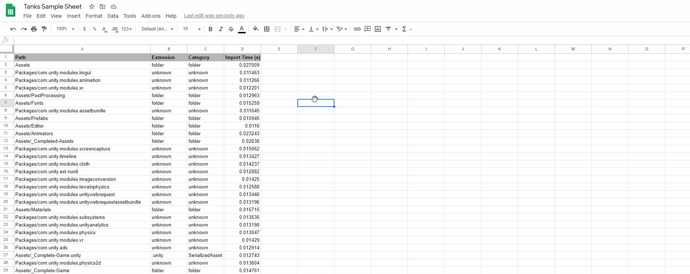

# SimpleEditorLogParser
These sample Scripts can be used to Parse an Editor.Log file and output a CSV to analyze import times for the Unity Editor

# Requirements:

[.NET 8 SDK](https://dotnet.microsoft.com/download/dotnet/8.0) (or newer) on Windows or macOS (Intel and Apple Silicon).

Check what you have installed with `dotnet --list-sdks`.

# Building:

Using Visual Studio, open up the Solution File in this project and build it.

Alternatively, via command line, from the root of this repository:

`dotnet build -c Release`

The output is written to `SimpleEditorLogParser/bin/Release/net8.0/`.

# How to use:

Using Visual Studio, open up the Solution File in this project and edit the Debug command line settings

Alternatively, via command line, from the build output folder use:

Windows:
`dotnet SimpleEditorLogParser.dll --path %LOCALAPPDATA%\Unity\Editor\Editor.log --output C:\Projects\Game01\CategorizedLog.csv`

macOS:
`dotnet SimpleEditorLogParser.dll --path ~/Library/Logs/Unity/Editor.log --output ~/Desktop/CategorizedLog.csv`

You can also build and run in one step from the root of this repository:

`dotnet run -c Release --project SimpleEditorLogParser -- --path <path to Editor.log> --output <path to output .csv>`

# Parameters:

*--path*

This is the full path to the log file you have

For example `C:\Projects\SimpleEditorLogParser\SampleLogs\Tanks_2019_4.log`

The Editor log for the most recent Unity session is found at:
- Windows: `%LOCALAPPDATA%\Unity\Editor\Editor.log`
- macOS: `~/Library/Logs/Unity/Editor.log`

*--output*

The location of where the output file should be made. The folder must already exist.
The output format is a CSV file with the following fields:

*Path,Extension,Category,Import Time (s)*

For example `C:\Projects\SimpleEditorLogParser\SampleLogs\Tanks_2019_4.csv`

